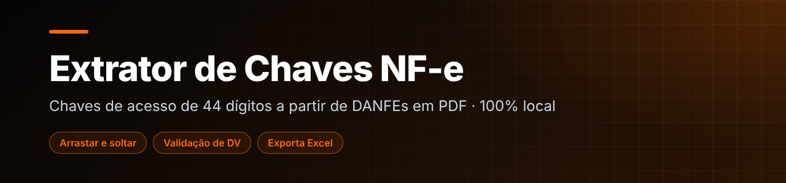
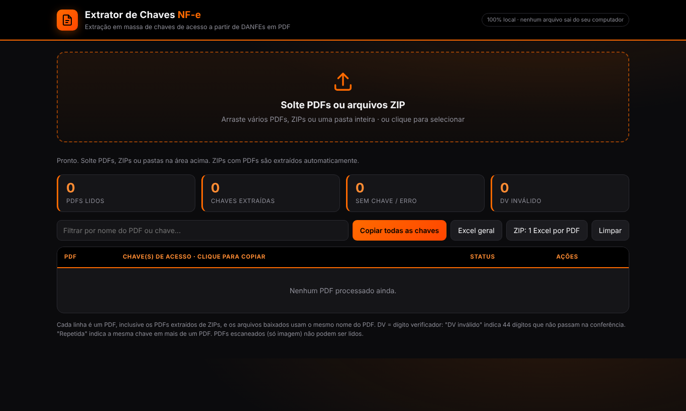

  

<h1 align="center">Extrator de Chaves de Acesso NF-e (DANFE)</h1>

Extração em massa das chaves de acesso de 44 dígitos a partir de DANFEs em PDF. Roda 100% local: nenhum arquivo sai do computador.

  

      

---

## 📌 Sobre

Resolve uma tarefa repetitiva de rotina fiscal/logística: abrir cada DANFE para copiar a chave de acesso. Aqui você solta os arquivos e recebe todas as chaves, já validadas, prontas para copiar ou exportar.

## 🖼️ Demonstração

  
   Área de arrastar e soltar, contadores e tabela de resultados

## ✨ Funcionalidades

- Arrastar e soltar de vários PDFs, arquivos **ZIP** ou pastas inteiras
- Validação do **dígito verificador (DV)** e sinalização de chaves repetidas e de PDFs sem chave
- Cópia rápida de uma chave ou de todas
- Exportação para **Excel**: um arquivo geral ou um Excel por PDF (em ZIP)

## 🛠️ Tecnologias

`HTML5` · `CSS3` · `JavaScript` · `PDF.js` · `SheetJS`

## ▶️ Como usar

Abra a demo, ou baixe o repositório e abra o `index.html` no navegador. Arraste os DANFEs para a área indicada.

Não precisa instalar nada nem rodar servidor: é só HTML, CSS e JavaScript.

## 📝 Observações

PDFs escaneados (somente imagem) não podem ser lidos, pois não há texto para extrair. As bibliotecas são carregadas por CDN.

---

## 👤 Autor

**Daniel da Silva Rezende** — estudante de Engenharia de Software e Análise e Desenvolvimento de Sistemas.

